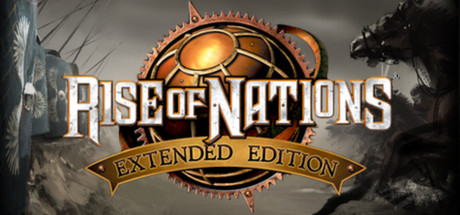

**Rise of Nations is the legendary real-time strategy game spanning 8 ages of history from Ancient to Information Age, where nations research technologies and advance through eras while managing supply lines, national borders, and Wonders of the World.**

---

## 📖 About

Rise of Nations is the legendary real-time strategy game spanning 8 ages of history from Ancient to Information Age, where nations research technologies and advance through eras while managing supply lines, national borders, and Wonders of the World.

## ⚠️ Problems Without Trainer

| Problem | Status |
|---------|--------|
| **Attrition System** — Fighting in enemy territory damages your units continuously without supply | ✅ Solved |
| **Age Advancement Timing** — Advancing ages too early or late can create resource imbalances | ✅ Solved |
| **Wonder Rushing** — Computer opponents often rush specific Wonders before players are ready | ✅ Solved |
| **Conquer the World** — Extended campaign requires managing multiple territories simultaneously | ✅ Solved |

## ✅ Solution

The **Rise of Nations Trainer** solves all these issues by giving you complete control over the game.

## 🎯 Full Feature List

- Unlimited Resources
- God Mode / Invincibility
- Instant Skill Cooldown
- One-Hit Kill
- Freeze Game Timer
- Unlock All Items & Achievements
- Custom Speed Multiplier
- Save State Anywhere

## 🚀 Quick Start

1. **Disable Windows Defender** temporarily (trainer may trigger false positive)
2. Download the trainer from the button above
3. Launch Rise of Nations
4. Run the trainer as Administrator
5. Activate desired cheats with hotkeys

## 💎 Free vs Paid

| Feature | Free | Pro |
|---------|------|-----|
| Basic God Mode | ✅ | ✅ |
| Unlimited Resources | ✅ | ✅ |
| All Advanced Cheats | ❌ | ✅ |
| Auto-Updates | ❌ | ✅ |
| Priority Support | ❌ | ✅ |

## 💻 Requirements

- Windows 10/11 (64-bit)
- Rise of Nations (any version)
- .NET Framework 4.8+
- DirectX 11+

## 🍎 macOS

macOS users can use our alternative tool:

## ⚖️ Legal

This trainer is for educational and single-player use only. Use responsibly.

---

